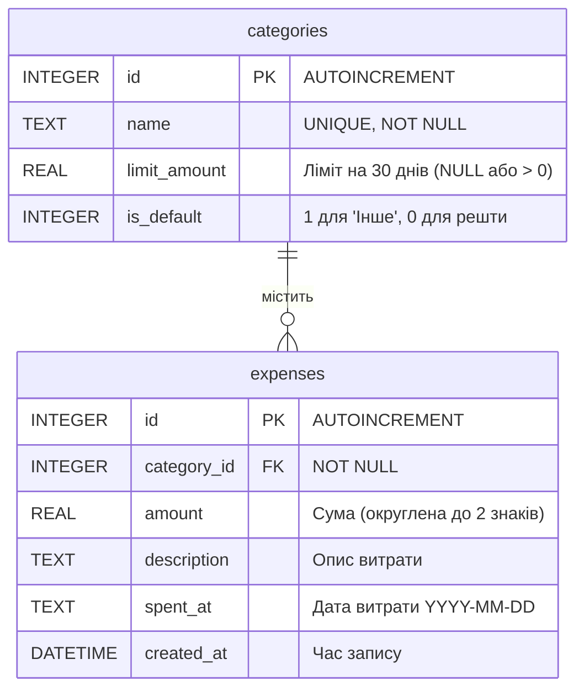

Створи файли README.md, definition-of-done.md, checklist.md, spec.md для проєкту на тему:
Expense Tracker (Трекер витрат) — вебінструмент для обліку особистих витрат та контролю лімітів за категоріями.

Основні можливості (In Scope):
- Додавання, перегляд, редагування та видалення витрат (сума, категорія, дата, опис).
- Редагування та видалення витрат за минулі місяці з автоматичним перерахунком усіх звітів та лімітів.
- Керування категоріями: створення, редагування назви, встановлення ліміту витрат на 30 днів, видалення категорії.
- Контроль лімітів: якщо при додаванні або редагуванні витрати сума по категорії за останні 30 календарних днів перевищує ліміт, витрата зберігається, але API повертає попередження (warning) у відповіді.
- Безпечне видалення категорій: при видаленні категорії всі її витрати автоматично переносяться в системну категорію «Інше» (яку не можна видалити).
- Формування звітів (за останні 30 календарних днів та за обраний календарний місяць):
  1. Загальна сума витрат за період.
  2. Розбивка витрат за категоріями (сума та частка).
  3. Стан лімітів по кожній категорії (ліміт, витрачено за останні 30 днів, залишок ліміту або сума перевищення).

Поза обсягом (Out of Scope):
- Авторизація, реєстрація та акаунти (застосунок розрахований на одного користувача).
- Спільний доступ або колаборація.
- Облік доходів, рахунків та загального балансу.
- Мультивалютність (усі суми виключно в гривнях — UAH).
- Повторювані платежі (підписки), імпорт банківських виписок та експорт у PDF/Excel.

Ключові архітектурні рішення та правила (відобразити в spec.md та ADR):
1. Зберігання грошей: суми зберігаються як дробові числа (REAL у SQLite / Number у JS — гривні з копійками). Щоб уникнути похибок IEEE 754 (наприклад, 0.1 + 0.2 = 0.30000000000000004), усі суми під час агрегації та у відповідях API примусово округлюються до 2 знаків після коми (`Math.round(val * 100) / 100`). Це рішення має бути зафіксоване як тема для ADR (`standards/adr/001-money-representation.md`: float з округленням проти цілих копійок).
2. Період для ліміту (ковзне вікно): останні 30 календарних днів включно з поточним днем за часовим поясом UTC (від поточної дати мінус 29 днів 00:00:00 до поточного моменту).
3. Перерахунок при змінах: звіти та ліміти не кешуються в окремих таблицях, а обчислюються динамічно на основі актуальних записів у БД. Якщо користувач редагує стару витрату (яка входить у 30-денне вікно) і це призводить до перевищення ліміту, система також повертає попередження у відповіді.

Критерії прийняття (Acceptance Criteria):
1. При створенні або редагуванні витрати, яка призводить до перевищення 30-денного ліміту категорії, запис успішно зберігається в БД (HTTP 200/201), а тіло відповіді містить поле `warning` із текстом попередження та сумою перевищення.
2. При видаленні будь-якої користувацької категорії всі пов'язані з нею витрати змінюють свій `category_id` на ID категорії «Інше», а спроба видалити категорію «Інше» повертає помилку 400 Bad Request.
3. При додаванні витрат на суми `0.10` та `0.20` грн загальна сума у звіті та перевірці ліміту дорівнює рівно `0.30` грн без артефактів плаваючої коми.
4. Зміна суми або видалення витрати за минулий чи поточний місяць миттєво змінює підсумки у звітах без необхідності ручного перерахунку.
5. Витрата з датою, старшою за 30 календарних днів від сьогодні, враховується в історичному звіті за відповідний місяць, але не впливає на поточний залишок ліміту категорії.

Обов'язковим є використання патернів Strategy, Command, Observer, Template Method, Flyweight наступним чином:
- Strategy (Стратегія) — у генерації звітів:
  Різні стратегії розрахунку та групування даних для звітів, наприклад `Rolling30DaysReportStrategy` (ковзне вікно для лімітів і дашборду) та `MonthlyBreakdownStrategy` (звіт за календарний місяць).
- Command (Команда) — для операцій зміни витрат (Create / Update / Delete) та можливості скасування останньої дії (Undo):
  Кожна модифікація витрати інкапсулюється в об'єкт команди, що дозволяє логувати дії або відкотити помилкове видалення/редагування.
- Template Method (Шаблонний метод) — у пайплайні обробки витрати (додавання та редагування):
  Базовий алгоритм: 1) Валідація вхідних даних і округлення суми до 2 знаків; 2) Збереження або оновлення запису в БД; 3) Перевірка ліміту за останні 30 днів; 4) Формування відповіді (з додаванням `warning`, якщо ліміт перевищено).
- Flyweight (Легковаговик) — для кешування метаданих категорій та їхніх валідаторів:
  Замість повторного створення об'єктів конфігурації категорій під час масової перевірки або побудови звітів, фабрика перевикористовує спільні екземпляри категорій у пам'яті.
- Observer (Спостерігач) — при зміні витрат:
  Коли витрата додається, редагується або видаляється, сповіщаються підписники: сервіс перевірки лімітів (`LimitCheckerObserver`) та сервіс оновлення статистики в інтерфейсі (`ReportUpdaterObserver`).

База даних (SQLite):
Таблиця категорій (`categories`):
- Зберігає назву категорії, місячний (30-денний) ліміт та прапорець системної категорії «Інше».
Таблиця витрат (`expenses`):
- Зберігає суму (`REAL`), опис, дату витрати (`spent_at` у форматі `YYYY-MM-DD`) та посилання на категорію.

Стек технологій:
- Backend: Node.js (REST API), SQLite.
- Frontend: чистий HTML5, CSS3, Vanilla JavaScript (`fetch` API).

Філософія розробки проєкту: чим менше коду = тим менше помилок можна допустити (стосується як людей, так і ШІ).

Вимоги до файлів:
- spec.md: розбиття на компоненти/модулі та взаємодія; дані та зв'язки (ER-діаграма); як дані оновлюються за ключовими сценаріями (додавання/редагування з перевищенням ліміту, видалення категорії, округлення сум, розрахунок 30 днів).
- мінімальний і чистий вигляд.

Структура проєкту:
/ai/sessions/
/ai/prompts-log.md
/public/index.html, style.css
/public/js/app.js
/server/core/
/server/db/
/server/routes/
/server/main.js
/standards/adr/
/standards/checklist.md, definition-of-done.md, spec.md
/tests/
Makefile
README.md
package.json