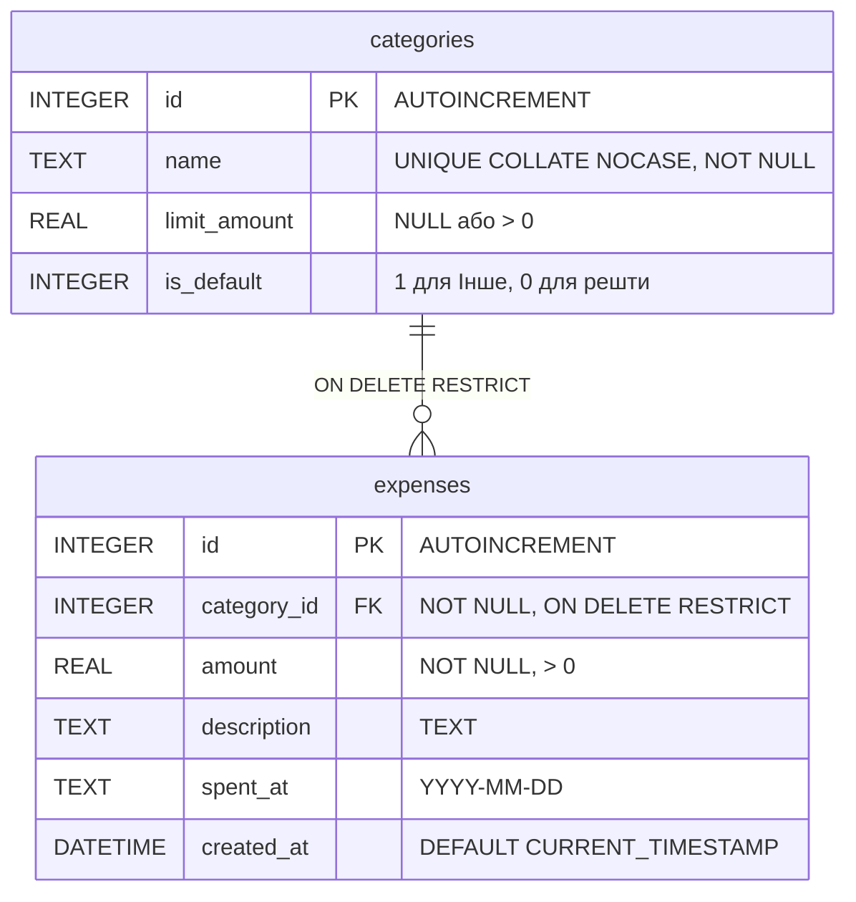

*Написано власноруч*

# Специфікація: Трекер витрат (Expense Tracker)

## 1. Межі проєкту

**У межах (In Scope):**
- Вебінструмент для одного користувача (без авторизації та акаунтів).
- CRUD для витрат (сума в грн, категорія, дата `YYYY-MM-DD`, опис) за будь-яку дату, включно з минулими місяцями.
- CRUD для категорій: назва, необов'язковий ліміт на 30 днів та системна категорія «Інше» (створюється автоматично під час ініціалізації БД).
- Звіт за останні 30 днів: загальна сума, розбивка за категоріями (сума й частка) та стан лімітів по кожній категорії (ліміт, витрачено за 30 днів, залишок або сума перевищення).
- Звіт за обраний календарний місяць (`YYYY-MM`): лише загальна сума та розбивка за категоріями за цей місяць (ліміти тут не показуються, оскільки вони діють виключно на ковзне вікно 30 днів).
- Службовий ендпоінт `GET /version`, який повертає поточну версію застосунку з `package.json`.

**Поза межами (Out of Scope):**
- Акаунти, авторизація та спільний доступ.
- Облік доходів і загального балансу рахунків.
- Мультивалютність (усі розрахунки тільки в UAH).
- Повторювані платежі (підписки), імпорт та експорт файлів.

## 2. Архітектура та компоненти

Стек: Node.js (REST API без важких фреймворків) + SQLite на бекенді; HTML5, CSS3 та Vanilla JS (`fetch`) на фронтенді.

```text
[ Браузер: UI (public/js/app.js) ]
               |
               v  HTTP (JSON)
[ Маршрути API (server/routes/) ]
               |
               v
[ Бізнес-логіка (server/core/) ]  --> округлення, валідація, вікно 30 днів, ліміти
               |
               v
[ Доступ до БД (server/db/) ]     --> SQLite (PRAGMA foreign_keys = ON)
```

- `server/routes/` — приймає HTTP-запити, передає параметри в сервіси та формує коди відповідей (200, 201, 400, 404).
- `server/core/` — перевіряє вхідні дані, округлює суми, обчислює межі 30-денного вікна за часовим поясом `Europe/Kyiv` та формує поле `warning` при перевищенні ліміту.
- `server/db/` — виконує параметризовані SQL-запити та транзакції SQLite.

## 3. Дані та бізнес-правила



- **Гроші та округлення:** суми зберігаються як `REAL` (гривні з копійками). Кожна вхідна сума (`amount`, `limit_amount`) спочатку округлюється за правилом `Math.round(val * 100) / 100`, і лише після округлення перевіряється умова додатного значення (тому `0.004` стає `0` і відхиляється з кодом 400). Усі суми у звітах також округлюються до 2 знаків. Компроміс між `float` і копійками (включно з поведінкою на межі `1.005`) зафіксовано в `standards/adr/001-money-representation.md`.
- **Часовий пояс і вікно 30 днів:** поточна календарна дата (`today`) визначається за часовим поясом `Europe/Kyiv`. Ковзне вікно охоплює 30 календарних днів включно з сьогоднішнім: від `today - 29 днів` до `today`. Дати з майбутнього (більші за `today` за Києвом), а також неіснуючі календарні дати (наприклад, `2026-02-30`) відхиляються з кодом 400.
- **Категорія «Інше» та унікальність назв:** перед збереженням назви категорій очищаються від пробілів по краях (`trim()`) і порівнюються без урахування регістру. Системну категорію «Інше» (`is_default = 1`) не можна видалити чи перейменувати, їй не можна встановити ліміт (`limit_amount` завжди `NULL`), а створити іншу категорію з назвою `"інше"` або `" Інше "` неможливо.

## 4. Ключові сценарії оновлення даних

- **Додавання та редагування витрати:** сервер округлює суму, валідує її та дату, після чого зберігає запис у `expenses`. Далі обчислюється сума витрат за останні 30 днів у цільовій категорії (при зміні категорії під час редагування — у новій). Якщо у категорії заданий ліміт і сума його перевищує, витрата залишається збереженою, а відповідь містить поле `warning`.
- **Видалення категорії:** виконується в одній SQL-транзакції — спочатку всі витрати цієї категорії переводяться в категорію «Інше» (`UPDATE`), після чого категорія видаляється (`DELETE`). На рівні БД зовнішній ключ `expenses.category_id` має обмеження `ON DELETE RESTRICT` (при увімкненому `PRAGMA foreign_keys = ON`), що унеможливлює появу «сиріт» навіть у разі помилки в коді. Оскільки «Інше» не має ліміту, перенесення не викликає `warning`.
- **Зміна ліміту категорії:** якщо користувач встановлює або знижує ліміт категорії так, що сума її витрат за останні 30 днів вже перевищує нове значення, ліміт зберігається в БД, але відповідь повертає `warning` із сумою перевищення.

## 5. Критерії прийняття

1. **Перевищення ліміту:** створення чи редагування витрати (зокрема зі зміною категорії), яке призводить до перевищення 30-денного ліміту цільової категорії, зберігає запис (HTTP 200/201) і повертає у відповіді `warning` із сумою перевищення; аналогічне попередження повертається при зниженні ліміту категорії нижче суми, вже витраченої за останні 30 днів.
2. **Захист і перенесення в «Інше»:** видалення користувацької категорії переносить усі її витрати в «Інше» без зміни загальної суми у звітах; спроба видалити чи перейменувати «Інше», задати їй ліміт або створити категорію з назвою `"інше"` / `" Інше "` повертає 400 Bad Request.
3. **Точність округлення:** після додавання витрат `0.10` та `0.20` грн їхня сума у звітах та при перевірці ліміту дорівнює рівно `0.30` грн.
4. **Межі 30-денного вікна (Europe/Kyiv):** за поточної київської дати `T` витрата з датою `T - 29 днів` включається у розрахунок ліміту, витрата за `T - 30 днів` не впливає на ліміт (проте враховується у звіті за відповідний місяць), а спроба передати майбутню дату `T + 1 день` повертає 400.
5. **Валідація вхідних даних:** запит із сумою, яка після округлення до 2 знаків менша або дорівнює 0 (наприклад, `0`, `-5`, `0.004`), порожньою назвою категорії, неіснуючим `category_id` або некоректною датою (не у форматі `YYYY-MM-DD` або недійсною датою на кшталт `2026-02-30`) повертає 400 Bad Request.
6. **Розмежування звітів:** звіт за календарний місяць повертає загальну суму та розбивку за категоріями лише за обраний місяць без полів ліміту, тоді як звіт за 30 днів додатково повертає ліміт, витрачену суму та залишок/перевищення по кожній категорії.