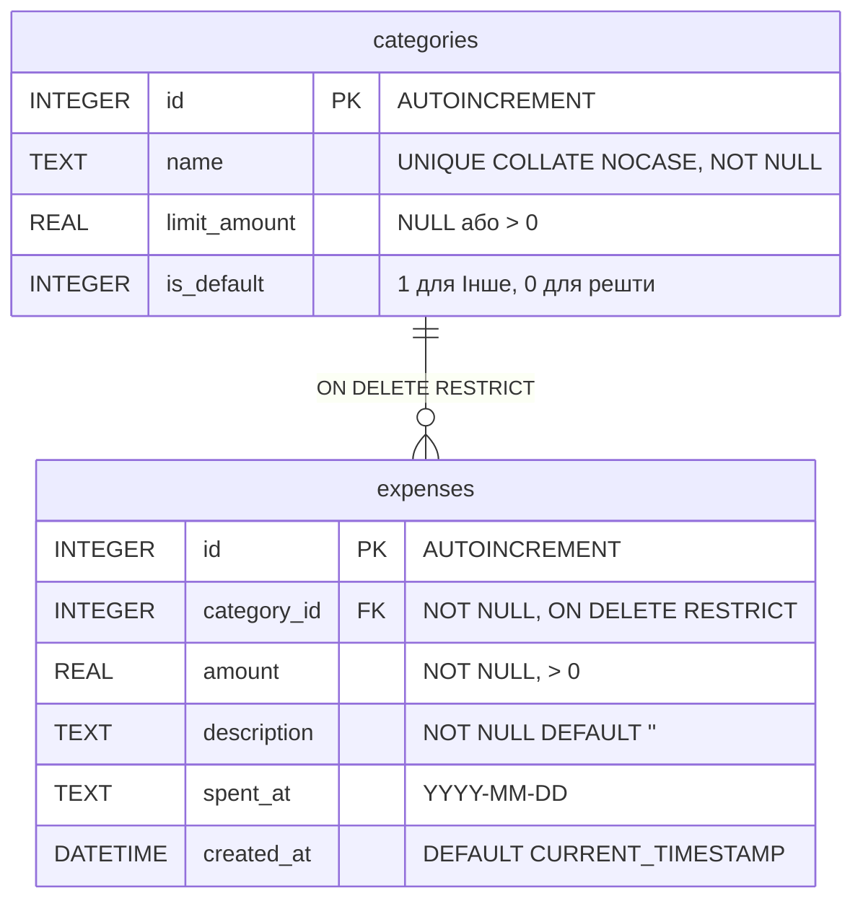

*Написано власноруч*

# Специфікація: Трекер витрат (Expense Tracker)

## 1. Межі проєкту

**У межах (In Scope):**
- Вебінструмент для одного користувача (без авторизації та акаунтів).
- CRUD для витрат: сума в грн, категорія, дата `YYYY-MM-DD`, необов'язковий опис (за замовчуванням `""`) за будь-яку дату, включно з минулими місяцями.
- CRUD для категорій: назва, необов'язковий ліміт на 30 днів та системна категорія «Інше» (створюється при ініціалізації БД).
- Звіт за останні 30 днів: загальна сума, розбивка за категоріями (сума й частка у % до 2 знаків; сума часток може становити 99.99%–100.01% через незалежне округлення) та стан лімітів (ліміт, витрачено за 30 днів, залишок або перевищення).
- Звіт за обраний календарний місяць (`YYYY-MM`): лише загальна сума та розбивка за категоріями за цей місяць (без лімітів).
- Ендпоінт `GET /version`, який повертає короткий Git SHA поточного коміту (`<sha>`).

**Поза межами (Out of Scope):**
- Акаунти, авторизація, спільний доступ.
- Облік доходів, балансу рахунків, мультивалютність (тільки UAH).
- Повторювані платежі (підписки), імпорт та експорт файлів.

## 2. Архітектура та компоненти

Стек: Bun + Fastify + bun:sqlite на бекенді; HTML5, CSS3 та Vanilla JS (`fetch`) на фронтенді.

```text
[ Браузер: UI (public/js/app.js) ]
               |  HTTP (JSON)
               v
[ Маршрути API (server/routes/) ] --> коди 200, 201, 400 (тіло/параметри), 404 (:id в URL)
               |
               v
[ Бізнес-логіка (server/core/) ]  --> округлення, валідація, вікно 30 днів, ліміти
               |
               v
[ Доступ до БД (server/db/) ]     --> SQLite (PRAGMA foreign_keys = ON)
```

## 3. Дані та бізнес-правила



- **Гроші та округлення:** суми зберігаються як `REAL`. Кожна вхідна сума (`amount`, `limit_amount`) спочатку округлюється за правилом `Math.round(val * 100) / 100`, і лише після цього перевіряється умова `> 0` (тому `0.004` стає `0` і дає 400). Усі суми у звітах також округлюються до 2 знаків. Компроміс між `float` і копійками (зокрема межа `1.005`) описано в `standards/adr/001-money-representation.md`.
- **Часовий пояс і вікно 30 днів:** поточна дата (`today`) визначається за часовим поясом `Europe/Kyiv`. Ковзне вікно охоплює 30 календарних днів включно з сьогоднішнім: від `today - 29 днів` до `today`. Майбутні дати (`> today` за Києвом) та неіснуючі дати (`2026-02-30`) відхиляються з кодом 400.
- **Категорія «Інше» та назви:** назви категорій проходять `trim()` і порівнюються без урахування регістру. Системну категорію «Інше» (`is_default = 1`) не можна видалити чи перейменувати, їй не можна задати ліміт (`limit_amount = NULL`), а дублікати на кшталт `"інше"` або `" Інше "` заборонені.

## 4. Ключові сценарії оновлення даних

- **Додавання та редагування витрати:** сервер округлює суму, валідує поля і зберігає запис. Далі рахується сума витрат за останні 30 днів у цільовій категорії (при зміні категорії — у новій). Якщо ліміт категорії перевищено, витрата зберігається, а відповідь містить поле `warning`.
- **Видалення категорії:** виконується в одній SQL-транзакції — спочатку всі її витрати переносяться в «Інше» (`UPDATE`), після чого категорія видаляється (`DELETE`). Оскільки «Інше» не має ліміту, `warning` не виникає.
- **Зміна ліміту категорії:** якщо новий ліміт менший за вже витрачену суму в цій категорії за останні 30 днів, ліміт зберігається, але відповідь повертає `warning` із сумою перевищення.

## 5. Критерії прийняття

1. **Перевищення ліміту:** створення/редагування витрати (зокрема зі зміною категорії) або зниження ліміту категорії, через яке витрати за 30 днів перевищують ліміт, зберігає зміни (200/201) і повертає `warning` із сумою перевищення.
2. **Категорія «Інше»:** видалення користувацької категорії переносить її витрати в «Інше» без зміни загальної суми у звітах; порушення будь-якого правила захисту чи унікальності «Інше» (див. розд. 3) повертає 400.
3. **Точність округлення:** після додавання витрат `0.10` та `0.20` грн їхня сума у звітах і при перевірці ліміту дорівнює рівно `0.30` грн.
4. **Межі 30-денного вікна (Europe/Kyiv):** за поточної київської дати `T` витрата за `T - 29 днів` входить у розрахунок ліміту, за `T - 30 днів` не впливає на ліміт (але входить у місячний звіт), а дата `T + 1 день` повертає 400.
5. **Валідація та коди 400 / 404:** сума `<= 0` після округлення (`0`, `-5`, `0.004`), порожня назва категорії, неіснуючий `category_id` у тілі запиту або недійсна дата (`2026-02-30`, не `YYYY-MM-DD`) повертають 400; звернення за неіснуючим `:id` ресурсу в URL (`PUT/DELETE /expenses/999`) повертає 404.
6. **Звіти та версія:** місячний звіт повертає суми й частки лише за обраний місяць без полів ліміту; 30-денний звіт додатково містить стан лімітів; `GET /version` повертає поточний Git SHA.