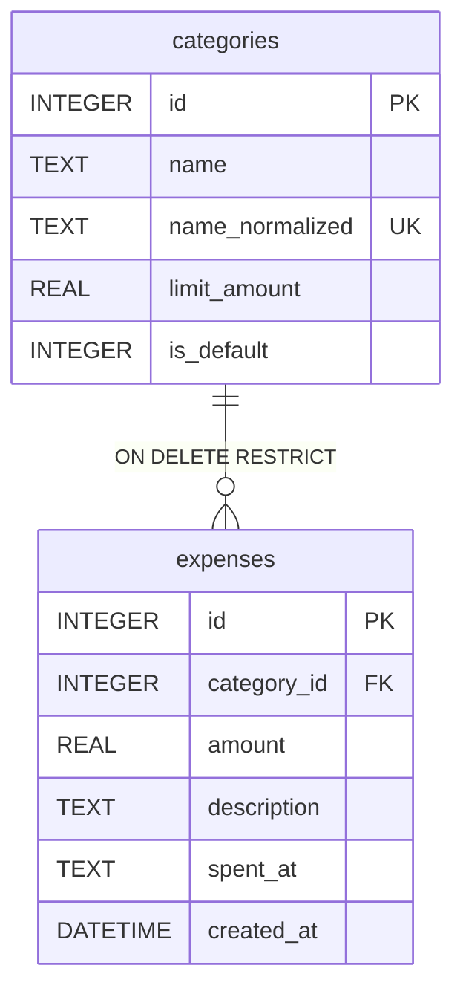

*Написано власноруч*

# Специфікація: Трекер витрат (Expense Tracker)

Деталі: контракт API — [`specs/api-contract.md`](specs/api-contract.md); схема БД (джерело істини) — [`server/db/schema.sql`](server/db/schema.sql); рішення — `standards/adr/001`–`003`.

## 1. Межі проєкту

**In Scope:** вебінструмент для одного користувача без авторизації; CRUD витрат (сума в UAH, категорія, дата `YYYY-MM-DD`, опис); CRUD категорій з необов'язковим лімітом на 30 днів і системною «Інше»; звіт за 30 днів (сума, частки за категоріями, стан лімітів); звіт за місяць `YYYY-MM` (без лімітів); `GET /version` — короткий Git SHA.

**Out of Scope:** акаунти, доходи й баланс, інші валюти, підписки, імпорт/експорт.

## 2. Архітектура та компоненти

Bun + Fastify + bun:sqlite; UI — HTML, CSS, Vanilla JS (`fetch`). `public/` → `server/routes/` (HTTP, коди 200/201/400/404) → `server/core/` (правила; `today` з інжектованого годинника, ADR 003) → `server/db/` (`PRAGMA foreign_keys = ON` на кожне з'єднання).

## 3. Дані та бізнес-правила

- **Гроші (ADR 001):** спершу округлення `Math.round(v * 100) / 100`, потім перевірка на скінченність і `> 0`. Сума за 30 днів округлюється перед порівнянням з лімітом. Частки — до 2 знаків; сума часток відхиляється від 100% не більше ніж на `0.005 × N` (N — категорій у звіті).
- **Час (ADR 003):** `today` — за `Europe/Kyiv`; вікно — від `today - 29` до `today` включно; дата витрати — реальна і не пізніша за `today`.
- **Назви (ADR 002):** `trim()`, непорожні, унікальні серед інших категорій за `trim().normalize('NFC').toLocaleLowerCase('uk')`.
- **«Інше»:** створюється ініціалізацією, БД не допускає другої; без ліміту; змінити чи видалити її не можна.
- **Ліміти:** перевищення не блокує збереження — відповідь містить `warning`.

## 4. Ключові сценарії оновлення даних

1. **Збереження витрати:** валідація → округлення → запис → перевірка ліміту цільової (при зміні — нової) категорії → `201`/`200` і `warning` за перевищення.
2. **Видалення витрати:** запис видаляється, `200`.
3. **Зміна категорії:** валідація назви й ліміту → запис → `warning`, якщо ліміт перевищено.
4. **Видалення категорії:** одна транзакція — витрати переносяться в «Інше», категорія видаляється; збій відкочує обидва кроки.
5. **Ініціалізація:** створює відсутні таблиці та «Інше»; повторний запуск другу «Інше» не створює.
6. **Помилки:** невалідні тіло чи query — `400`, дані не змінюються; неіснуючий чи нечисловий `:id` — `404`.

## 5. Критерії прийняття

1. **Ліміт:** перевищення (витрата, її перенесення в іншу категорію, зниження ліміту) зберігає зміни й повертає `warning`; рівно на ліміті `warning` немає.
2. **Гроші:** `0.10 + 0.20` дає `0.30` у звітах; за ліміту `0.30` `warning` немає.
3. **Видалення категорії:** витрати в «Інше», загальна сума незмінна; збій транзакції нічого не змінює; прямий `DELETE` категорії з витратами відхиляє `ON DELETE RESTRICT`.
4. **Назви:** `"інше"`, `" Інше "`, `"їжа"` (є `"Їжа"`), зміна чи видалення «Інше» — 400; `"Їжа"` → `"їжа"` тієї ж категорії — 200.
5. **Час:** `T - 29` і `T` у вікні, `T - 30` — ні (але в місячному звіті), `T + 1` — 400; `now = 2026-07-15T21:30:00Z` дає `today = 2026-07-16`, а `2026-01-15T21:30:00Z` — `2026-01-15`.
6. **Валідація:** 400 — суми `0`, `-5`, `0.004`, `"12.5"`, `1e308`; назви `""`, `"   "`; неіснуючий `category_id`; дати `2026-02-30`, `2026-2-3`; `month` `2026-13`, `2026-1`, майбутній чи відсутній. 404 — `PUT /expenses/999`, `/expenses/abc`.
7. **Звіти:** поля відповідають контракту; місячний — без полів лімітів; період без витрат — `total = 0`, `categories = []`.
8. **Версія:** `GET /version` повертає SHA за правилами контракту.
9. **Ініціалізація:** після створення БД і повторного старту «Інше» існує в одному екземплярі.

## 6. Відкриті питання

- Межі довжини назви, опису й суми; апострофи (`'`, `’`, `ʼ`) і гомогліфи (латинська `I` / кирилична `І`) у назвах.
- Відкладено: `checkValidity()` перед `fetch` у UI (ADR 001); `RangeError` під час імпорту, якщо `Europe/Kyiv` не підтримується (ADR 003).
