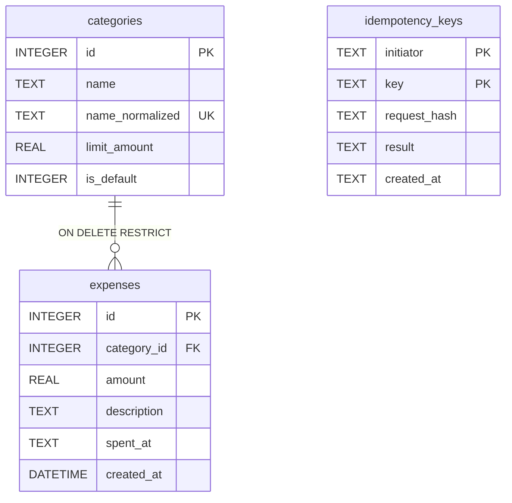

# БД: запити, транзакції, помилки — Expense Tracker

Доповнює [`spec.md`](../spec.md) і [`api-contract.md`](api-contract.md). Схема (джерело істини) — [`server/db/schema.sql`](../server/db/schema.sql). Рішення: межі транзакцій і шари — ADR 007; `bun:sqlite`, з'єднання, старт — ADR 008; ідемпотентність і ретраї — ADR 010.

Файл описує SQLite-реалізацію сховища (`server/repositories/sqlite/`, `server/db/`). In-memory реалізація (ADR 007) має ті самі методи й ту саму поведінку без SQL; винятки — `ON DELETE RESTRICT` і `SQLITE_BUSY`, яких у неї немає.

Позначення: `T` — `today` за `Europe/Kyiv` (ADR 003); `W = [T - 29, T]`; `D` — `id` категорії «Інше». Номери (`E2`, `C4` …) — для посилань з тестів і PR.

## Схема



### Таблиця ключів ідемпотентності (ADR 010)

Додається в `schema.sql`:

```sql
CREATE TABLE IF NOT EXISTS idempotency_keys (
  initiator    TEXT NOT NULL,           -- користувач з X-User (spec, розд. 3)
  key          TEXT NOT NULL,           -- Idempotency-Key, 1–128 символів [A-Za-z0-9._:-]
  request_hash TEXT NOT NULL CHECK (length(request_hash) = 64),   -- SHA-256 методу, шляху й тіла
  result       TEXT NOT NULL CHECK (json_valid(result)),          -- знімок результату транзакції
  created_at   TEXT NOT NULL,           -- лише now().toISOString(): UTC з 'Z'; порівнюється як рядок
  PRIMARY KEY (initiator, key)
) WITHOUT ROWID;
CREATE INDEX IF NOT EXISTS idempotency_keys_created_at ON idempotency_keys (created_at);
```

Термін зберігання — 24 год від `created_at`. Прострочені ключі видаляються на початку кожного `POST` з ключем; окремого планувальника немає. Зберігаються лише успішні результати.

### Індекси

| Індекс | Колонки | Обслуговує |
|---|---|---|
| PK `categories.id`, `expenses.id` | `rowid` | пошук за `:id`; перевірка FK `category_id` |
| `sqlite_autoindex_categories_1` (`UNIQUE`) | `name_normalized` | дублікат назви (C2, C3) |
| `categories_single_default` | `is_default WHERE is_default = 1` | одна «Інше»; пошук `D` (C4, старт) |
| `expenses_category_spent_at` | `(category_id, spent_at)` | сума категорії за `W` (E2, E3, C3, R1); перенесення витрат і перевірка `RESTRICT` (C4) |
| `expenses_spent_at` | `spent_at` (+ `rowid`) | список E1 без сортування; діапазон у звітах R1, R2 |
| PK `idempotency_keys` | `(initiator, key)` | пошук ключа (I) |
| `idempotency_keys_created_at` | `created_at` | видалення прострочених ключів (I) |

`amount` не входить у жоден індекс, тож `SUM(amount)` читає рядки таблиці після пошуку за індексом; для обсягів одного користувача це прийнятно. Плани нижче перевірено через `EXPLAIN QUERY PLAN` на порожній БД (Bun 1.4.4, 2026-11-13); після `ANALYZE` на даних планувальник може обрати інакше, тому їх закріплює тест.

## З'єднання і старт (ADR 008)

Одне з'єднання на процес, відкриває `server/main.js`:

```sql
PRAGMA foreign_keys = ON;
PRAGMA busy_timeout = 0;        -- ADR 010: чекання лише через асинхронні ретраї
-- schema.sql: CREATE TABLE / INDEX IF NOT EXISTS, вставка «Інше», якщо її немає
PRAGMA foreign_keys;                               -- має бути 1
SELECT id FROM categories WHERE is_default = 1;   -- рівно один рядок
```

Перевірка до `listen()`, по кроках:

1. Відкрити файл. Неіснуючий каталог явно заданого `DB_PATH` → `SQLITE_CANTOPEN`.
2. Виконати `schema.sql`. Файл, що не є БД → `SQLITE_NOTADB`.
3. `PRAGMA foreign_keys` повертає `1`.
4. «Інше» існує рівно в одному екземплярі (критерій 9).

Будь-яка помилка — запис `fatal` у лог і `process.exit(1)`, порт не відкривається (критерій 12). Старт не ретраїться, зокрема на `SQLITE_BUSY`.

## Транзакції

Кожен запит до БД виконується всередині однієї з двох меж, які оголошує сервіс (ADR 007); метод репозиторію поза межею кидає помилку.

| Межа | SQL | Операції |
|---|---|---|
| `withTransaction` | `BEGIN IMMEDIATE` (`db.transaction(…).immediate()`) | E2 `POST /expenses`, E3 `PUT /expenses/:id`, E4 `DELETE /expenses/:id`, C2 `POST /categories`, C3 `PUT /categories/:id`, C4 `DELETE /categories/:id` |
| `withRead` | `BEGIN DEFERRED` (`db.transaction(…).deferred()`) | E1 `GET /expenses`, C1 `GET /categories`, R1 звіт за 30 днів, R2 місячний звіт |

- Багатокрокові записи, де атомарність несе зміст: **C4** (перенесення витрат і видалення категорії, критерії 3, 13) і **E2, C2 з `Idempotency-Key`** (ресурс і ключ записуються разом, критерій 11).
- **R1** читає двома запитами, і `withRead` гарантує, що обидва бачать один стан БД.
- Функція всередині межі синхронна; `async`-функція дає `TypeError` і відкат (ADR 007, ADR 008).
- На `SQLITE_BUSY` межа повторює всю функцію: до 5 повторів з паузами 25, 50, 100, 200, 400 мс ±50% через `await`, потім `StorageUnavailableError` (ADR 010). Функція не має побічних дій поза сховищем, тож повтор нічого не дублює.

## Запити за сценаріями

### Ідемпотентність (I)

Частина `withTransaction` для E2 і C2, лише коли прийшов `Idempotency-Key`. `initiator`, `hash` і `now` сервіс обчислює до входу в межу (ADR 009, ADR 010).

```sql
DELETE FROM idempotency_keys WHERE created_at < :cutoff;      -- now − 24 год; idempotency_keys_created_at
SELECT request_hash, result FROM idempotency_keys
WHERE initiator = :initiator AND key = :key;                  -- PK
-- є, хеш збігається → повернути result, решту кроків пропустити
-- є, хеш інший     → IdempotencyMismatchError (422)
-- немає            → кроки сценарію, потім:
INSERT INTO idempotency_keys (initiator, key, request_hash, result, created_at)
VALUES (:initiator, :key, :hash, :result_json, :now);
```

### Витрати

**E1. `GET /expenses`** — `withRead`, 1 запит.

```sql
SELECT id, category_id, amount, description, spent_at, created_at
FROM expenses ORDER BY spent_at DESC, id DESC;
```

План: `SCAN expenses USING INDEX expenses_spent_at`, без `USE TEMP B-TREE FOR ORDER BY`: кожен запис вторинного індексу закінчується `rowid` (= `id`), тож потрібний порядок дає зворотний обхід індексу.

**E2. `POST /expenses`** — `withTransaction`; spec, сценарій 1.

```sql
-- [I], якщо є ключ
SELECT limit_amount FROM categories WHERE id = :category_id;           -- PK; 0 рядків → ValidationError (400)
INSERT INTO expenses (category_id, amount, description, spent_at)
VALUES (:category_id, :amount, :description, :spent_at)
RETURNING id, category_id, amount, description, spent_at, created_at;
SELECT SUM(amount) FROM expenses                                       -- лише якщо limit_amount не NULL
WHERE category_id = :category_id AND spent_at BETWEEN :from AND :to;   -- expenses_category_spent_at
-- [I] INSERT INTO idempotency_keys
```

План суми: `SEARCH expenses USING INDEX expenses_category_spent_at (category_id=? AND spent_at>? AND spent_at<?)`. Функція транзакції повертає `{ expense, limit_amount, spent }`; `SUM` порожньої вибірки (`NULL`) — це `0`, округлення й `warning` рахує `core/` (ADR 001).

**E3. `PUT /expenses/:id`** — `withTransaction`; spec, сценарій 1.

```sql
SELECT limit_amount FROM categories WHERE id = :category_id;           -- PK; 0 рядків → ValidationError (400)
UPDATE expenses
SET category_id = :category_id, amount = :amount, description = :description, spent_at = :spent_at
WHERE id = :id
RETURNING id, category_id, amount, description, spent_at, created_at;  -- PK; 0 рядків → NotFoundError (404)
-- сума за W для нової категорії, як у E2
```

Категорія перевіряється раніше за витрату, тож неіснуючий `:id` з неіснуючою категорією дає `400`.

**E4. `DELETE /expenses/:id`** — `withTransaction`; spec, сценарій 2.

```sql
DELETE FROM expenses WHERE id = :id;                                   -- PK; changes = 0 → NotFoundError (404)
```

### Категорії

**C1. `GET /categories`** — `withRead`, 1 запит.

```sql
SELECT id, name, limit_amount, is_default FROM categories ORDER BY id; -- SCAN categories
```

Категорій одиниці—десятки, тож повний перегляд прийнятний. Порядок для клієнта — відкрите питання spec.

**C2. `POST /categories`** — `withTransaction`.

```sql
-- [I], якщо є ключ
SELECT 1 FROM categories WHERE name_normalized = :nn;                  -- autoindex; є → DuplicateNameError (400)
INSERT INTO categories (name, name_normalized, limit_amount)
VALUES (:name, :nn, :limit_amount)
RETURNING id, name, limit_amount, is_default;
-- [I] INSERT INTO idempotency_keys
```

**C3. `PUT /categories/:id`** — `withTransaction`; spec, сценарій 3.

```sql
SELECT is_default FROM categories WHERE id = :id;                      -- PK; 0 рядків → 404; 1 → ValidationError (400)
SELECT 1 FROM categories WHERE name_normalized = :nn AND id != :id;    -- autoindex; є → 400
UPDATE categories SET name = :name, name_normalized = :nn, limit_amount = :limit_amount
WHERE id = :id RETURNING id, name, limit_amount, is_default;
SELECT SUM(amount) FROM expenses
WHERE category_id = :id AND spent_at BETWEEN :from AND :to;            -- expenses_category_spent_at
```

**C4. `DELETE /categories/:id`** — `withTransaction`; spec, сценарій 4.

```sql
SELECT is_default FROM categories WHERE id = :id;                      -- PK; 0 рядків → 404; 1 → 400
SELECT id FROM categories WHERE is_default = 1;                        -- categories_single_default → D
UPDATE expenses SET category_id = :D WHERE category_id = :id;          -- expenses_category_spent_at
DELETE FROM categories WHERE id = :id;                                 -- PK; RESTRICT перевіряє expenses тим самим індексом
```

Плани: `SEARCH categories USING COVERING INDEX categories_single_default`; `SEARCH expenses USING COVERING INDEX expenses_category_spent_at (category_id=?)`. Без індексу з лівою колонкою `category_id` і `UPDATE`, і перевірка `RESTRICT` сканували б усю `expenses`.

### Звіти

Кожен звіт — фіксована кількість запитів з `GROUP BY` і `JOIN` для назв, а не запит на категорію (критерій 14).

**R1. `GET /reports/last-30-days`** — `withRead`, рівно 2 запити.

```sql
SELECT e.category_id, c.name, SUM(e.amount) AS total
FROM expenses e JOIN categories c ON c.id = e.category_id
WHERE e.spent_at BETWEEN :from AND :to
GROUP BY e.category_id;

SELECT c.id, c.name, c.limit_amount, COALESCE(SUM(e.amount), 0) AS spent
FROM categories c
LEFT JOIN expenses e ON e.category_id = c.id AND e.spent_at BETWEEN :from AND :to
WHERE c.limit_amount IS NOT NULL
GROUP BY c.id;
```

Плани: перший — `SEARCH e USING INDEX expenses_spent_at`, `SEARCH c USING INTEGER PRIMARY KEY`, `USE TEMP B-TREE FOR GROUP BY` (груп стільки, скільки категорій); другий — `SCAN c` і для кожної категорії з лімітом `SEARCH e USING INDEX expenses_category_spent_at`. Округлення, частки й сортування за сумою — у `core/` після запиту.

**R2. `GET /reports/monthly?month=YYYY-MM`** — `withRead`, рівно 1 запит.

```sql
SELECT e.category_id, c.name, SUM(e.amount) AS total
FROM expenses e JOIN categories c ON c.id = e.category_id
WHERE e.spent_at >= :month_start AND e.spent_at < :next_month_start
GROUP BY e.category_id;
```

`:next_month_start` для грудня — `YYYY+1-01-01` (календарна арифметика ADR 003). План — як перший запит R1. `LIKE '2026-10-%'` не використовується: без `PRAGMA case_sensitive_like` він дає `SCAN expenses`.

## Помилки БД

Репозиторій розпізнає помилку за `error.code` (перевірено: порушення `UNIQUE` дає `SQLITE_CONSTRAINT_UNIQUE`, `errno` 2067), а сімейство `SQLITE_BUSY` — за `(error.errno & 0xff) === 5`. Котре саме обмеження порушено, визначає метод репозиторію, у якому сталася помилка, а не текст повідомлення.

| Код SQLite | Де | Ретрай | Доменна помилка | HTTP |
|---|---|---|---|---|
| `SQLITE_BUSY`, `SQLITE_BUSY_*` | будь-яка межа, зокрема `COMMIT` | до 5 повторів (ADR 010) | `StorageUnavailableError` | `503`, `Retry-After: 1` |
| `SQLITE_CONSTRAINT_UNIQUE` на `name_normalized` | C2, C3: дублікат оминув попередню перевірку | ні | `DuplicateNameError` | `400` |
| `SQLITE_CONSTRAINT_FOREIGNKEY` на `INSERT`/`UPDATE expenses` | E2, E3: категорії не існує | ні | `ValidationError` (`category_id`) | `400` |
| `SQLITE_CONSTRAINT_FOREIGNKEY` на `DELETE categories` | C4: `RESTRICT` спрацював, бо перенесення пропустило витрати | ні | — | `500` (баг) |
| `SQLITE_CONSTRAINT_CHECK`, `SQLITE_CONSTRAINT_NOTNULL` | будь-який запис: валідація пропустила невалідне значення | ні | — | `500` (баг) |
| `SQLITE_CONSTRAINT_UNIQUE` на `categories_single_default`, `SQLITE_CONSTRAINT_PRIMARYKEY` на `idempotency_keys` | лише через баг: пошук у тій самій транзакції мав це виключити | ні | — | `500` (баг) |
| `SQLITE_FULL`, `SQLITE_READONLY`, `SQLITE_IOERR*`, `SQLITE_CORRUPT` | під час роботи | ні | — | `500`; сервер працює далі |
| `SQLITE_CANTOPEN`, `SQLITE_NOTADB`, помилка `schema.sql` | старт | ні | — | процес завершується, код `≠ 0` |

- Доменні помилки без власного коду SQLite: `NotFoundError` (`404`) — `RETURNING` чи `changes` дали 0 рядків; `IdempotencyMismatchError` (`422`) — ключ з іншим хешем.
- Помилка без рядка в таблиці перекидається як є й дає `500`.
- Для кожного `500` транзакцію відкочено, у лозі є код SQLite, `reqId` і `bpId` (ADR 009); клієнт бачить лише `{ "error": "Внутрішня помилка сервера" }`.

## Тести, що випливають

- Плани E1, E2 (сума), R1, R2, C4 містять `USING … INDEX`, не містять `SCAN expenses`; E1 — без `USE TEMP B-TREE FOR ORDER BY`.
- Критерій 9: повторний старт на тій самій БД лишає одну «Інше». Критерій 12: неіснуючий каталог `DB_PATH` і файл з довільними байтами → код виходу `≠ 0`.
- Критерій 11: повтор з тим самим ключем → один запис; інше тіло → `422`; прострочений ключ (фіксований годинник) → новий запис.
- Критерій 13: виняток між `UPDATE` і `DELETE` у C4 → стан БД ідентичний до запиту, `500`.
- Критерій 14: лічильник виконань statement-ів (ADR 008) для 1 і 20 категорій: R1 = 2, R2 = 1.
- Критерій 17: друге з'єднання тримає `BEGIN IMMEDIATE` довше за всі спроби → `503`; відпускає між спробами → `201`. Перевіряється результат і кількість спроб, не час.
- Перевірка дубліката підмінена так, що нічого не знаходить → `INSERT` падає з `SQLITE_CONSTRAINT_UNIQUE` → `400`.